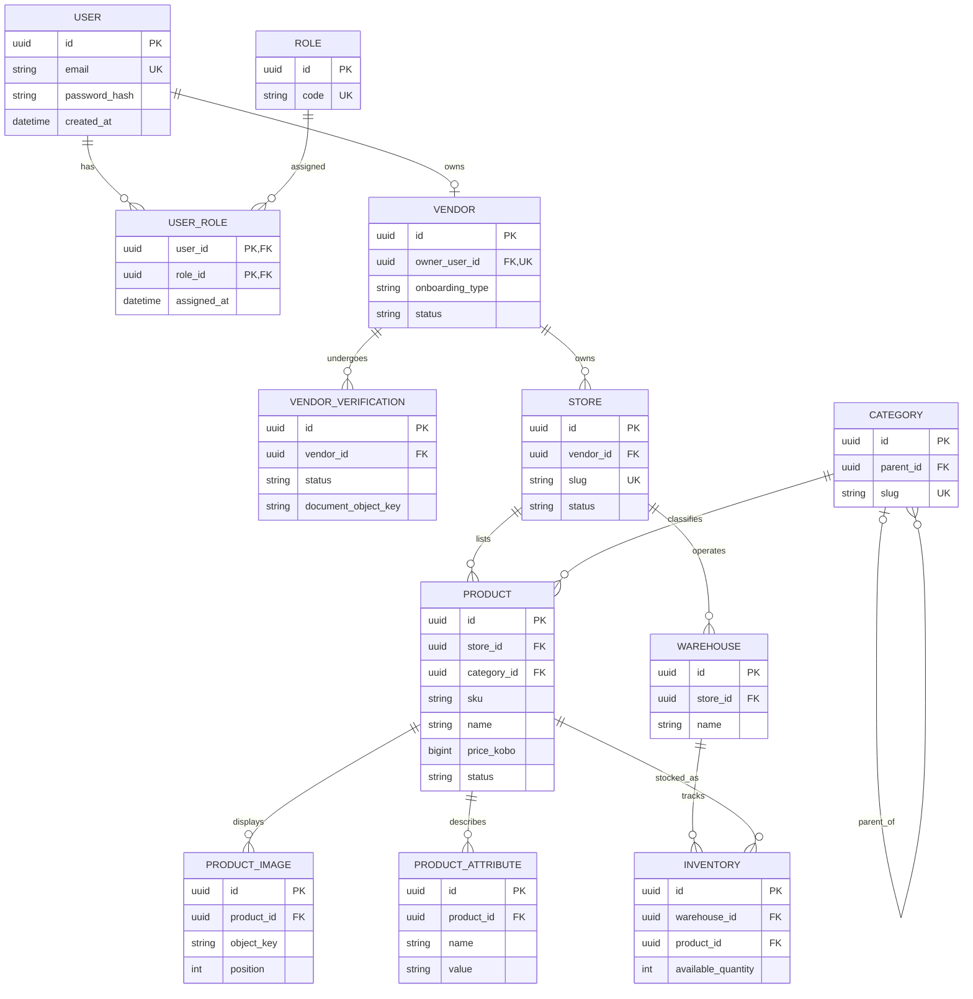
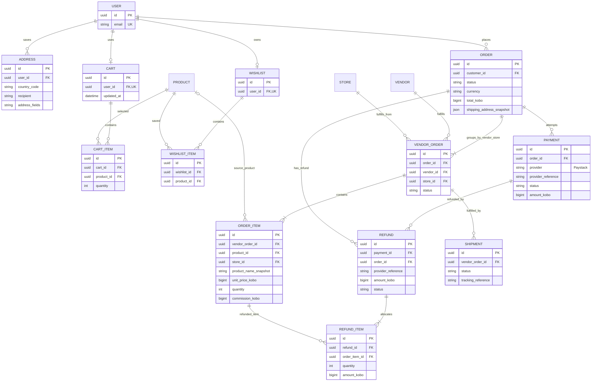
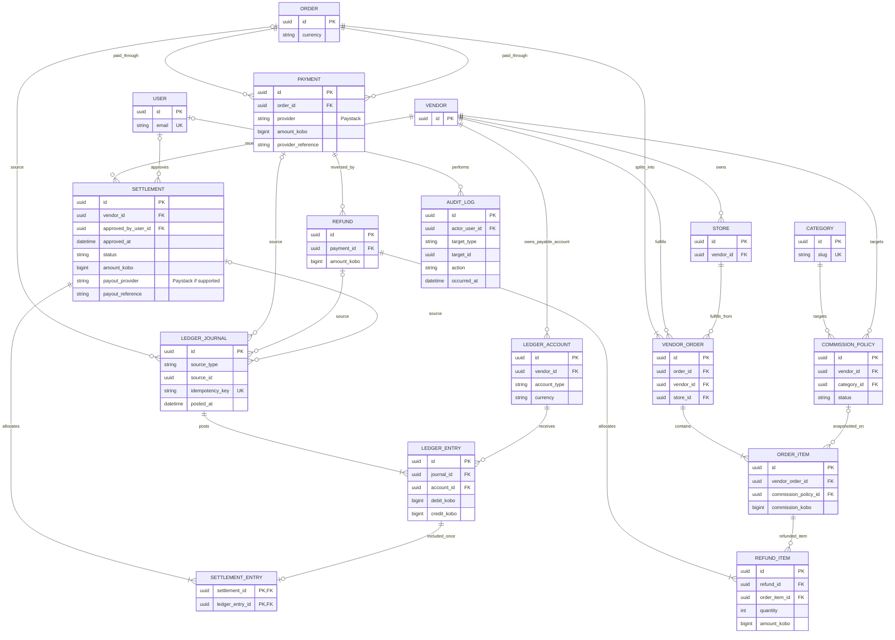

# Entity Relationships

This document shows proposed logical relationships, not a deployed schema.
`PK` means primary key; `FK` means foreign key. UUIDs are assumed for
identifiers. The initial schema remains in one PostgreSQL database and one
NestJS modular monolith.

The owner-approved MVP launches in Nigeria with NGN/kobo and Paystack, with
future multi-country support kept possible through explicit country and
currency fields. Vendor settlements require admin approval. See
[Database Architecture](./DATABASE_ARCHITECTURE.md) for all approved
decisions and remaining implementation details.

## Identity, vendors, and catalogue

In the MVP, a vendor has one owner user; a user may own zero or one vendor.
Vendor staff/membership is intentionally a later join model. A product has one
primary category; a category may have a parent category. Inventory is separate
from product descriptions and is unique for each warehouse/product pair.

## Customer, checkout, and fulfillment

The order’s address is a snapshot, not a live join to an editable customer
address. One parent order can have products from multiple stores; `VendorOrder`
groups the items by store/vendor for fulfillment while payment applies to the
parent checkout. The order item retains product, price, quantity,
store/vendor, commission, and discount snapshots so historical orders remain
explainable after catalogue changes or deletion. A nullable `product_id` may
be retained for reference if catalogue deletion/anonymization is allowed;
snapshots remain authoritative for the order. `RefundItem` records each
refunded order item, quantity, and allocated refund amount.

## Financial ledger and settlement

`SETTLEMENT_ENTRY` is an allocation/link table, not a second balance. The MVP
links each payable ledger entry to at most one settlement and settles it in
full; partial settlement needs a separately designed allocation model.
In the implemented schema, source references may use typed nullable foreign
keys or a carefully constrained source model; do not use unconstrained
polymorphic IDs for critical integrity without an explicit integrity
strategy. Journals and entries are append-only and must balance per currency.
