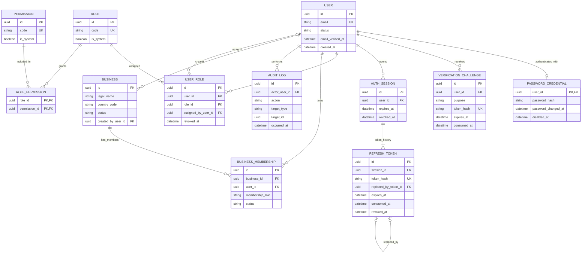

# Identity Schema Design

## Status and scope

This is the formal logical design for the shared identity and access-control
foundation. It is documentation only: it does not create Prisma models,
migrations, or application behavior. The proposed tables are intended for a
later identity migration in the existing NestJS modular monolith, using Neon
PostgreSQL and Prisma 7.10.1 with the current ESM/NodeNext configuration.
REST routes remain under `/api/v1`.

The identity foundation supports one account across Goods, Services, Storage,
Affiliate & Marketing, and Agents. It owns account authentication, global
staff authorization, business identity/membership, and security audit. It
does not own ecosystem marketplace profiles, listings, orders, bookings,
rentals, mandates, or verification evidence specific to those domains.

## Approved decisions

1. Email is the registration and login identifier.
2. Vendor onboarding must eventually support both individuals and registered
   businesses.
3. One user may own or be associated with multiple vendor profiles.
4. Marketplace capabilities are expressed by specialized ecosystem profiles,
   not global marketplace roles.
5. Initial global staff roles are `SUPER_ADMIN`, `ADMIN`, `OPERATIONS`, and
   `CUSTOMER_SUPPORT`.
6. One account supports all five ecosystems.
7. Support multiple authenticated sessions, rotating refresh tokens, token
   reuse detection, individual logout, and logout-all.
8. A future `VendorProfile` may be owned by either a user or a business, but
   never both at once.
9. Keep marketplace profiles out of the initial identity migration.
10. Use UUID identifiers, UTC timestamps, foreign keys, append-only audit,
    Argon2id password hashes, and hashes—not raw values—for refresh tokens.
11. Staff roles are assigned only through protected server-side processes.
    A global role does not grant ownership of marketplace resources.

These are product/architecture decisions. Field layouts, exact lifecycle
transitions, retention periods, and database implementation details below
remain proposed until approved in the implementation phase.

## Architecture overview and boundaries

The identity domain distinguishes:

- **User:** ecosystem-neutral account and account lifecycle.
- **PasswordCredential:** password-authentication material, separate from
  account profile and stored only as an Argon2id hash.
- **VerificationChallenge:** single-use, purpose-bound proof token for email
  verification or password recovery; not an account-wide or marketplace
  verification decision.
- **AuthSession / RefreshToken:** device/session lifecycle and rotating opaque
  credentials. The database stores token hashes and lineage, not raw tokens.
- **Role / Permission:** system-managed global staff authorization catalogue.
- **UserRole:** audited grant of a global staff role to a user.
- **Business / BusinessMembership:** business identity and a user's scoped
  relationship with that business.
- **AuditLog:** append-only security and privileged-action history.

Marketplace-specific capability is represented later in its owning module:

| Ecosystem capability | Later profile/domain owner | Not a global role |
|---|---|---|
| Goods vendor | Goods `VendorProfile` | `VENDOR` |
| Services provider | Services `ProfessionalProfile` | `SERVICE_PROVIDER` |
| Storage owner | Storage `StorageOwnerProfile` | `STORAGE_OWNER` |
| Affiliate marketer | Affiliate `AffiliateProfile` | `AFFILIATE` |
| Agent | Agents `AgentProfile` plus scoped mandate | `AGENT` |
| Shopper | User account participating as customer | `SHOPPER` |

Profile existence, profile state, verification state, business membership,
resource ownership, and staff role are different facts. A user may hold
multiple profiles. Any domain action must check the resource, owner,
membership, mandate, relevant status, and requested action; a global role
alone never grants resource ownership or unrestricted access.

## Proposed initial model inventory

All identifiers are PostgreSQL UUIDs. Timestamps are `TIMESTAMPTZ` in UTC.
`createdAt`/`updatedAt` are application-managed consistently or use database
defaults consistently; the implementation must choose and test one approach.
Names below are logical proposal, not finalized Prisma field names.

### User

| Field | Proposed type | Notes |
|---|---|---|
| `id` | UUID | Primary key. |
| `email` | `VARCHAR(320)` | Canonicalized email used for registration/login; unique. |
| `emailVerifiedAt` | `TIMESTAMPTZ NULL` | Null until email verification succeeds. |
| `status` | enum | Proposed: `PENDING_VERIFICATION`, `ACTIVE`, `SUSPENDED`, `ANONYMIZED`. |
| `createdAt` | `TIMESTAMPTZ` | Creation time. |
| `updatedAt` | `TIMESTAMPTZ` | Last account-state/profile change. |
| `anonymizedAt` | `TIMESTAMPTZ NULL` | Set only through approved privacy workflow. |

Email normalization is performed consistently before uniqueness checks and
storage. Do not silently apply provider-specific alias rules such as removing
plus-tags or dots. The normalization/case-folding implementation must be
selected and tested before registration ships.

The initial migration also adds a unique PostgreSQL expression index on
`LOWER(email)` as a database-level case-insensitive uniqueness backstop. This
does not replace the registration canonicalization policy or settle its exact
case-folding semantics.

**Relationships:** one User has zero or one PasswordCredential; zero or many
VerificationChallenges, AuthSessions, UserRoles, and BusinessMemberships.
AuditLog may reference a User as actor. There is no global `verified` flag
beyond contact verification; marketplace verification belongs to its profile
or domain.

### PasswordCredential

| Field | Proposed type | Notes |
|---|---|---|
| `userId` | UUID | Primary key and FK to User; enforces one credential row per user. |
| `passwordHash` | `TEXT` | Argon2id encoded hash only; never plaintext. |
| `passwordChangedAt` | `TIMESTAMPTZ` | Last successful password replacement. |
| `disabledAt` | `TIMESTAMPTZ NULL` | Disables password login without deleting account. |
| `createdAt`, `updatedAt` | `TIMESTAMPTZ` | Credential lifecycle timestamps. |

One user has at most one current password credential in this initial design.
Additional login providers or credential history are out of scope until
approved. Never return or log this record's hash.

### VerificationChallenge

| Field | Proposed type | Notes |
|---|---|---|
| `id` | UUID | Primary key. |
| `userId` | UUID | Required FK to User. Registration creates a pending account before issuing the challenge. |
| `purpose` | enum | Proposed: `EMAIL_VERIFICATION`, `PASSWORD_RESET`. |
| `tokenHash` | `VARCHAR(255)` | Unique hash of a high-entropy, single-use opaque token; never store the raw token. |
| `expiresAt` | `TIMESTAMPTZ` | Challenge expiry. |
| `consumedAt` | `TIMESTAMPTZ NULL` | Set once by a conditional consume operation. |
| `attemptCount` | `INTEGER` | Non-negative; for bounded verification attempts if needed. |
| `createdAt` | `TIMESTAMPTZ` | Issued time. |

One user may have multiple challenges over time. Index by `(userId, purpose,
createdAt)` and expiry/consumption for cleanup. A challenge is valid only for
its user, purpose, expiry, and unconsumed state. Challenge retention and
resend throttling are implementation/policy decisions. Do not place raw
challenge values in audit records or logs.

### AuthSession

| Field | Proposed type | Notes |
|---|---|---|
| `id` | UUID | Primary key; session identifier. |
| `userId` | UUID | Required FK to User. |
| `createdAt` | `TIMESTAMPTZ` | Session start. |
| `lastSeenAt` | `TIMESTAMPTZ NULL` | Optional activity timestamp; update policy must avoid excessive writes. |
| `expiresAt` | `TIMESTAMPTZ` | Absolute session expiry. |
| `revokedAt` | `TIMESTAMPTZ NULL` | Set for individual logout, logout-all, reuse response, or security action. |
| `revokeReason` | enum/text nullable | Minimized reason code; never include credential material. |
| `userAgent` | `VARCHAR(512) NULL` | Optional minimized device metadata; consider storing a normalized summary instead. |
| `ipAddress` | `INET NULL` | Optional; collect only if justified, restrict access, and define retention. |

One user may have many sessions. A session has a sequence of RefreshTokens.
The session is usable only when not revoked/expired and its user remains
eligible to authenticate. `revokedAt` and `expiresAt` are authoritative;
avoid a redundant status column unless a demonstrated query requirement
justifies it.

### RefreshToken

| Field | Proposed type | Notes |
|---|---|---|
| `id` | UUID | Primary key. |
| `sessionId` | UUID | Required FK to AuthSession. |
| `tokenHash` | `VARCHAR(255)` | Unique cryptographic hash of a high-entropy opaque token. |
| `issuedAt` | `TIMESTAMPTZ` | Issue time. |
| `expiresAt` | `TIMESTAMPTZ` | Token expiry, no later than its session expiry. |
| `consumedAt` | `TIMESTAMPTZ NULL` | Set once when rotation succeeds. |
| `revokedAt` | `TIMESTAMPTZ NULL` | Explicit invalidation. |
| `replacedByTokenId` | UUID nullable | Self-FK to the successor token created by rotation; unique when non-null. A composite FK with `sessionId` requires the successor to belong to the same session. |

Each token belongs to one session; a session has a sequence of tokens. A
successful refresh consumes the presented token and creates exactly one
successor in the same session. Retain consumed token hashes/lineage at least
long enough for the approved reuse-detection window; do not delete the
evidence while the session or detection policy depends on it.

### Role

| Field | Proposed type | Notes |
|---|---|---|
| `id` | UUID | Primary key. |
| `code` | enum or `VARCHAR(64)` | Unique stable code; initial codes are the four approved staff roles only. |
| `name` | `VARCHAR(120)` | Display label. |
| `description` | `TEXT NULL` | Administrative purpose. |
| `isSystem` | `BOOLEAN` | Protect built-in role definitions from ordinary administration. |
| `createdAt`, `updatedAt` | `TIMESTAMPTZ` | Catalogue timestamps. |

Initial codes: `SUPER_ADMIN`, `ADMIN`, `OPERATIONS`, and
`CUSTOMER_SUPPORT`. Seed these through controlled deployment/bootstrap
operations. Do not seed or add shopper/vendor/provider/affiliate/agent roles.

### Permission

| Field | Proposed type | Notes |
|---|---|---|
| `id` | UUID | Primary key. |
| `code` | `VARCHAR(128)` | Unique, stable permission identifier. |
| `description` | `TEXT` | Human-readable purpose. |
| `isSystem` | `BOOLEAN` | System-managed catalogue entry. |
| `createdAt`, `updatedAt` | `TIMESTAMPTZ` | Catalogue timestamps. |

Permissions should represent explicit staff actions, not profile existence
or ownership. Initial permission granularity is proposed and must be reviewed
for least privilege before staff endpoints are exposed.

### RolePermission

| Field | Proposed type | Notes |
|---|---|---|
| `roleId` | UUID | FK to Role. |
| `permissionId` | UUID | FK to Permission. |
| `createdAt` | `TIMESTAMPTZ` | Assignment time. |

Composite primary key `(roleId, permissionId)` prevents duplicate grants.
This is a system-managed mapping, not a user-editable permission grant.

### UserRole

| Field | Proposed type | Notes |
|---|---|---|
| `id` | UUID | Primary key, preserving assignment history. |
| `userId` | UUID | FK to User. |
| `roleId` | UUID | FK to Role; only approved global staff roles. |
| `assignedByUserId` | UUID nullable | FK to assigning User; null for an approved bootstrap/system action. |
| `assignedAt` | `TIMESTAMPTZ` | Grant time. |
| `revokedByUserId` | UUID nullable | FK to revoking User. |
| `revokedAt` | `TIMESTAMPTZ NULL` | Null while the assignment is current. |

An assignment history row represents one grant interval. Add a partial unique
index on `(userId, roleId) WHERE revokedAt IS NULL` so a user cannot hold
duplicate active grants while historical grants remain. Role grant/revoke
requires protected server-side workflow and an AuditLog record.

### Business

| Field | Proposed type | Notes |
|---|---|---|
| `id` | UUID | Primary key. |
| `legalName` | `VARCHAR(255)` | Legal/business name. |
| `countryCode` | `CHAR(2)` | ISO country; Nigeria is initial market but country is explicit. |
| `status` | enum | Proposed: `PENDING`, `ACTIVE`, `SUSPENDED`, `CLOSED`. |
| `createdByUserId` | UUID | FK to creator, not an ownership substitute. |
| `createdAt`, `updatedAt` | `TIMESTAMPTZ` | Lifecycle timestamps. |

Business registration identifiers and evidence are intentionally omitted
until collection, access, verification, and retention policies are approved.
A business may have many memberships. This shared record is not a vendor or
other marketplace profile.

### BusinessMembership

| Field | Proposed type | Notes |
|---|---|---|
| `id` | UUID | Primary key. |
| `businessId` | UUID | Required FK to Business. |
| `userId` | UUID | Required FK to User. |
| `membershipRole` | enum | Proposed business-scoped roles: `OWNER`, `ADMIN`, `MEMBER`; not global roles. |
| `status` | enum | Proposed: `INVITED`, `ACTIVE`, `SUSPENDED`, `REVOKED`. |
| `invitedByUserId` | UUID nullable | FK to inviting User. |
| `revokedByUserId` | UUID nullable | FK to revoking User. |
| `createdAt`, `updatedAt` | `TIMESTAMPTZ` | Membership lifecycle. |
| `acceptedAt`, `revokedAt` | `TIMESTAMPTZ NULL` | Lifecycle timestamps. |

Membership authority is limited to the referenced business and its resources.
Never infer vendor profile ownership or authority from membership without a
domain-specific ownership/authorization check. A user may have memberships
in multiple businesses; a business may have multiple users.

### AuditLog

| Field | Proposed type | Notes |
|---|---|---|
| `id` | UUID | Primary key. |
| `actorUserId` | UUID nullable | FK to User; required for `USER` actors and null for `SYSTEM` actors. |
| `actorType` | enum | `USER` or `SYSTEM`; unknown/unattributed actors are not represented by this enum. |
| `action` | `VARCHAR(128)` | Stable event/action code. |
| `targetType` | `VARCHAR(128)` | Logical target type. |
| `targetId` | UUID nullable | Target UUID; polymorphic target has no FK and must not replace domain FKs. |
| `occurredAt` | `TIMESTAMPTZ` | UTC event time. |
| `requestId` | `VARCHAR(128) NULL` | Correlation/request identifier. |
| `outcome` | enum/text | Success or failure category. |
| `metadata` | `JSONB NULL` | Minimized, allowlisted context only. Never include passwords, token values, hashes, secrets, or full verification documents. |

Audit rows are append-only and have no `updatedAt`. Index by
`(targetType, targetId, occurredAt)`, `(actorUserId, occurredAt)`, and
`requestId` when used. Retention and access must be governed; application
roles must not update or delete records. A database check requires a non-null
`actorUserId` for `USER` and a null `actorUserId` for `SYSTEM`.

## Relationship diagram

The line between User and Business denotes the creator relationship only;
ownership and business authority are represented through active
BusinessMembership records. The future VendorProfile relationship is
deliberately not shown as an initial entity.

## Cardinality and future ownership

- One User has zero or one PasswordCredential; the credential FK is its
  primary key.
- One User has many VerificationChallenges and AuthSessions. A session has
  one or more RefreshToken history rows; a rotated token points to at most
  one successor.
- Role and Permission are many-to-many through RolePermission.
- User and global staff Role are many-to-many over time through UserRole.
  At most one active grant for a given user/role pair is allowed.
- User and Business are many-to-many through BusinessMembership. Membership
  grants authority only inside that business.
- User may create many Business records; creator is audit attribution, not an
  ownership relation.
- Each AuditLog row may reference one actor User; its polymorphic target is
  descriptive only.
- A future VendorProfile may be owned by an individual User **or** a
  Business, never both. The future table should have nullable `ownerUserId`
  and `businessId` FKs plus a PostgreSQL check constraint enforcing exactly
  one is non-null. There must be no unique constraint on `ownerUserId`, since
  one user may own multiple vendor profiles. Whether multiple vendor profiles
  may reference the same business remains a domain decision.
- A user may be associated with a business-owned vendor profile through
  later Goods-domain membership/authorization. `BusinessMembership` alone
  does not grant vendor-profile permissions; the Goods module must establish
  the required resource-scoped grant.

## Foreign-key delete behavior

| Relationship | Proposed delete action | Rationale |
|---|---|---|
| `PasswordCredential.userId → User.id` | `RESTRICT` | Disable or replace credentials through lifecycle operations; do not erase account history by cascade. |
| `VerificationChallenge.userId → User.id` | `RESTRICT` | Expire/consume and retention-clean challenges explicitly; account removal is not a cascade. |
| `AuthSession.userId → User.id` | `RESTRICT` | Revoke sessions and preserve security history. |
| `RefreshToken.sessionId → AuthSession.id` | `RESTRICT` | Preserve rotation/reuse evidence until retention cleanup is approved. |
| `RefreshToken.replacedByTokenId/sessionId → RefreshToken.id/sessionId` | `RESTRICT` | Composite FK keeps the successor in the same session and preserves token lineage; cleanup must be ordered and policy-controlled. |
| `RolePermission.roleId/permissionId → Role/Permission.id` | `RESTRICT` | System authorization catalogue entries cannot disappear while referenced. |
| `UserRole.userId/roleId → User/Role.id` | `RESTRICT` | Preserve grant history; revoke rather than delete assignments. |
| `UserRole.assignedByUserId/revokedByUserId → User.id` | `SET NULL` | Optional actor attribution can be removed only under an approved privacy process; audit event remains. |
| `Business.createdByUserId → User.id` | `RESTRICT` | Keep creator attribution while the account row is retained; anonymize account data rather than physically deleting the user. |
| `BusinessMembership.userId/businessId → User/Business.id` | `RESTRICT` | Revoke membership explicitly; never cascade away the relationship history. |
| `BusinessMembership.invitedByUserId/revokedByUserId → User.id` | `SET NULL` | These optional actor references may be cleared under approved privacy handling. |
| `AuditLog.actorUserId → User.id` | `RESTRICT` | Preserve immutable audit attribution; anonymize account data without physically deleting the referenced User row. |
| Future `VendorProfile.ownerUserId/businessId → User/Business.id` | `RESTRICT` | Goods-domain resource ownership must not disappear through identity deletion. |

No identity row should be physically removed as the ordinary logout,
suspension, credential-change, membership-revocation, or role-revocation
operation. Retention cleanup is a separate, audited process.

## Roles, permissions, and profiles

Only the four approved staff roles belong in Role. Seed and manage them as
system data, with permission mappings reviewed for least privilege.
`SUPER_ADMIN` bootstrap and recovery must be a controlled, audited deployment
or operational process; do not expose public self-assignment or ordinary
administrative escalation.

Marketplace capabilities are profile/domain state, not Role rows. A User can
participate in all five ecosystems with the same account. A domain module
decides whether its profile is active/verified and whether the User owns,
belongs to, or is explicitly authorized for the requested resource.

BusinessMembership has a business-scoped membership role and status. It
cannot be used as a global role or as proof of ownership of every vendor,
store, listing, or other resource associated with that business.

## Refresh-token rotation and reuse detection

1. Generate a cryptographically random opaque refresh token. Return its raw
   value only to the client over the selected secure transport; store only a
   one-way cryptographic digest (for example, SHA-256) of the token. High
   entropy makes password hashing inappropriate; use indexed exact lookup
   and never disclose the digest.
2. On refresh, hash the presented token and locate its row. In one database
   transaction, conditionally mark it consumed only if it is unconsumed,
   unrevoked, unexpired, and its session is active and unexpired. Verify the
   affected-row count is exactly one.
3. Create the successor RefreshToken in the same session and link
   `replacedByTokenId` to preserve lineage. Commit consumption and successor
   creation atomically; issue the raw successor only after transaction
   success.
4. Concurrent refresh requests race on the conditional update. Only one can
   consume the token. If another request presents the now-consumed token,
   treat it as reuse: in a separate successful transaction revoke the session
   and all still-active tokens in that session, then return an unauthenticated
   response. Do not restore or re-issue a token.
5. For unknown, malformed, expired, revoked, or already-consumed tokens,
   return a generic authentication failure. Only a token known to belong to
   the session and identified as previously consumed should trigger reuse
   response; the exact public response remains generic to avoid leakage.
6. Individual logout revokes the authenticated session and outstanding tokens
   transactionally. Logout-all revokes all active sessions/tokens for the
   authenticated user in one transaction. Password change, account
   suspension, and other security events should follow the approved policy
   for revoking existing sessions.

Database enforcement should include unique token hashes, unique non-null
successor references, and a partial unique index allowing at most one
unconsumed/unrevoked token per session. The same-session composite successor
foreign key is deferred until transaction commit, allowing the consumed
predecessor to be linked before its successor is inserted in the same
transaction. A token can be expired while still unconsumed, so expiration is
checked in application SQL and not embedded in the partial-index predicate.
The partial index is a backstop, not a substitute for conditional updates and
transactions. The implementation must account for Prisma transaction
isolation, affected-row counts, and retry/serialization errors.

The reuse-detection retention window and session absolute/idle lifetimes are
unresolved policy decisions. Do not purge token history before the approved
detection window.

## Lifecycle and delete behavior

Proposed lifecycle states (exact transitions are implementation proposals):

- **User:** `PENDING_VERIFICATION` → `ACTIVE`; eligible accounts may transition
  to `SUSPENDED`; privacy processing may transition to `ANONYMIZED`.
- **PasswordCredential:** enabled or disabled, represented by `disabledAt`;
  password changes replace the hash and update `passwordChangedAt`.
- **VerificationChallenge:** issued, consumed, expired, or invalidated. Store
  timestamps rather than a redundant mutable status where possible.
- **AuthSession:** active until expiry or revocation; no physical delete in
  normal logout/security workflows.
- **RefreshToken:** issued, consumed/replaced, revoked, or expired; preserve
  hash/lineage for the approved reuse-detection retention period.
- **Role / Permission / RolePermission:** system-managed catalogue and
  mappings; changes are controlled, versioned operationally, and audited
  rather than physically deleting referenced authorization records.
- **UserRole:** grant interval ends by setting `revokedAt`; retain grant
  history and audit event.
- **Business:** `PENDING`, `ACTIVE`, `SUSPENDED`, or `CLOSED` (proposed).
- **BusinessMembership:** `INVITED`, `ACTIVE`, `SUSPENDED`, or `REVOKED`
  (proposed).

Prefer soft state transitions and anonymization to physical account deletion.
Use `RESTRICT` for User references from credentials, sessions, challenges,
business memberships, and durable audit. Credentials and active session data
are disabled/revoked through lifecycle operations. `SET NULL` applies only to
the optional actor references on UserRole and BusinessMembership when
approved privacy handling requires it. AuditLog.actorUserId remains
`RESTRICT`; anonymize account data rather than deleting a referenced User.
RolePermission references should `RESTRICT` deletion of system catalogue
entries; user-role history should not cascade-delete. Business memberships
should be revoked, not cascade-deleted. Any short-lived challenge cleanup
must preserve account integrity and follow retention rules.

## Constraints, indexes, and Prisma migration SQL

### Standard constraints/indexes

- Unique `User.email` after deterministic canonicalization; enforce `NOT
  NULL`. Do not depend solely on application pre-checks.
- `PasswordCredential.userId` primary key/FK to enforce one-to-one.
- Unique `VerificationChallenge.tokenHash`; indexes on `(userId, purpose,
  createdAt)` and `(expiresAt, consumedAt)`.
- `AuthSession` index `(userId, revokedAt, expiresAt)` for session listing and
  logout-all.
- Unique `RefreshToken.tokenHash`; index `(sessionId, issuedAt)` and
  `(sessionId, consumedAt, revokedAt)`.
- Unique non-null `RefreshToken.replacedByTokenId` so a token cannot be the
  successor of multiple predecessors. A composite unique key on
  `(id, sessionId)` and composite self-FK on
  `(replacedByTokenId, sessionId)` require the successor to belong to the
  same session.
- Composite primary key `(roleId, permissionId)` on RolePermission.
- Unique stable Role and Permission codes.
- UserRole FK indexes; BusinessMembership unique/current lookup indexes and
  FK indexes. Do not make user ID unique in either relation.
- AuditLog indexes by target/time, actor/time, and request ID where useful.
- Check counters are non-negative; ensure expiry is later than issue/creation
  at insert/update boundaries where appropriate.

### PostgreSQL-specific SQL likely required

Prisma schema cannot express every desired invariant directly. Include and
review custom SQL in the migration for:

1. **Active UserRole uniqueness:** partial unique index on `(user_id, role_id)`
   where `revoked_at IS NULL`, preserving revoked assignment history.
2. **Current BusinessMembership uniqueness:** partial unique index on
   `(business_id, user_id)` where `revoked_at IS NULL`, preserving revoked
   membership records while preventing duplicate current memberships.
3. **Single current refresh token per session:** partial unique index on
   `session_id` where `consumed_at IS NULL AND revoked_at IS NULL`.
4. **Exactly-one VendorProfile owner:** future-only check constraint:
   `(owner_user_id IS NOT NULL) <> (business_id IS NOT NULL)`.
5. **Audit actor consistency:** a check requires `actor_type = 'USER'` to have
   a non-null `actor_user_id`, and `actor_type = 'SYSTEM'` to have a null
   `actor_user_id`. Unattributed/unknown actors are not represented.
6. **Append-only audit:** database privileges must deny UPDATE/DELETE to the
   application role. If database-level triggers are selected as defense in
   depth, add and test them in custom SQL; Prisma model syntax alone does not
   make a table append-only.
7. **Row-level checks:** add custom `CHECK` constraints if the selected
   Prisma version/schema cannot express them for non-negative challenge
   attempts, valid issue/expiry timestamp ordering, and consistent revoked
   timestamps for role/membership lifecycle rows.
8. **Token lineage:** use a deferred composite self-referencing foreign key on
   `(replacedByTokenId, sessionId)` to `(id, sessionId)` so a successor
   cannot belong to another session. Deferring it until commit permits the
   predecessor update and successor insertion to remain atomic in one
   transaction. This does not prevent cycles, races, replay, or invalid
   lifecycle transitions; those require application-level transactional
   enforcement.

Prisma support for `CHECK` constraints and partial indexes is version- and
feature-dependent; do not assume the schema declaratively enforces them.
Migration SQL must be the source of truth for these invariants and be covered
by database integration tests. Avoid time-dependent index predicates such as
`expires_at > now()`; PostgreSQL index predicates must be immutable.

Foreign-key delete actions should be explicitly declared and reviewed in
Prisma models/migrations. Index referencing FK columns used in joins and
authorization lookups; PostgreSQL does not automatically index FK columns.

## Security and audit requirements

- Argon2id password hashes only; configure parameters according to current
  deployment capacity and security review. Never log credentials, hashes, or
  reset/verification token values.
- Generate opaque refresh/challenge values using a cryptographically secure
  random source; persist hashes only. Return values only through protected
  response channels.
- Enforce generic login/recovery errors, rate limits, bounded verification
  attempts, and abuse monitoring without exposing account existence.
- Protect registration/login transport with TLS. For browsers use secure,
  HttpOnly cookies and an explicit SameSite/CSRF/origin policy. Future Flutter
  token storage and transport must be separately reviewed.
- Use conditional database updates and transactions to prevent concurrent
  token reuse. Revoke a session on confirmed replay; audit the event without
  token material.
- Only protected staff workflows may assign global roles. Audit grant,
  revocation, business membership changes, account suspension, session
  revocation-all, credential changes, and security-sensitive challenge use.
- Audit metadata is allowlisted and minimized. It must not include passwords,
  token values, token hashes, credential hashes, secrets, full IP/user-agent
  data without approval, or verification document contents.
- Use database least privilege, encrypted transport, secret-manager storage,
  and restricted access to identity/verification data.
- Define account anonymization, token/challenge retention, audit retention,
  data-subject requests, and jurisdiction-specific legal retention before
  implementation.

## Unresolved policy and implementation decisions

The architecture decisions above are approved; the following details are
not:

1. Email canonicalization and case-folding semantics, email delivery,
   verification expiry, resend limits, and whether an unverified user can
   access any authenticated capabilities.
2. Password length/strength policy, Argon2id parameters and upgrade strategy,
   password recovery expiry/rate limits, and session revocation after
   password change.
3. Browser cookie attributes, CSRF/origin strategy, access-token/session
   mechanism and lifetime, session idle/absolute timeout, and device/session
   limits.
4. Refresh-token hash construction, reuse-detection window, expired-token
   history retention, handling of legitimate client retries after a lost
   rotation response, and exact response/alert policy when reuse is detected.
5. Role-permission matrix, initial grants per staff role, `SUPER_ADMIN`
   bootstrap/recovery, separation of duties, and permission-change process.
6. Business registration identifiers, verification, owner/member rules,
   ownership transfer, and whether businesses may own multiple profiles of a
   given ecosystem.
7. User and identity audit retention, anonymization/legal holds, IP/device
   metadata collection, and access review.
8. Whether phone numbers or additional authentication methods will be added
   later; email remains the approved registration/login identifier for this
   design.

## Phase 5.1.3 onward implementation sequence

1. **Approve schema details:** resolve the policies above that block field
   definitions, lifecycle transitions, retention, or API security behavior.
   Record decisions before writing migrations or public endpoints.
2. **Finalize migration design:** map these logical entities to Prisma 7.10.1
   models, review relation names/actions and generated SQL, prepare custom
   partial indexes/check constraints, and confirm Neon development/test
   branch usage. Do not connect this identity migration to production.
3. **Add schema and migration:** create only the approved identity models;
   seed the four system staff roles and approved permissions idempotently.
   Verify migrations against a disposable or designated development database.
4. **Implement identity primitives:** email canonicalization, Argon2id
   credential service, account lifecycle, email challenges, generic errors,
   rate limits, and safe DTO/logging rules.
5. **Implement session lifecycle:** secure session creation, refresh rotation,
   conditional consume and successor creation in one transaction, replay
   response/revocation, individual logout, logout-all, and approved
   credential-change session revocation.
6. **Implement staff RBAC:** protected role assignment, permission mapping,
   bootstrap controls, and audit. Verify that staff roles do not bypass
   resource-level ownership/membership checks.
7. **Implement business membership:** invitation/acceptance and revocation
   only after membership role, owner, verification, and transfer policies are
   approved. Keep authority scoped to the specific business.
8. **Test and harden:** test uniqueness races, token refresh concurrency,
   replay detection, revocation, permission denial, business-scope isolation,
   audit redaction, migration constraints, and account lifecycle. Run API
   lint, typecheck, unit/e2e tests, build, Prisma validation/generation, and
   existing health/Swagger regressions.
9. **Add ecosystem profiles in their own phases:** implement VendorProfile
   during Goods onboarding and other profiles in their ecosystem phases.
   For VendorProfile enforce exactly one User-or-Business owner, support
   multiple profiles per user, and do not treat profile presence as global
   authorization.

## Related documentation

- [Database Architecture](./DATABASE_ARCHITECTURE.md) describes the
  cross-ecosystem database and financial boundaries.
- [Entity Relationships](./ENTITY_RELATIONSHIP.md) shows identity and
  marketplace relationship diagrams.
- [Data Dictionary](./DATA_DICTIONARY.md) summarizes proposed logical fields.
- [Development Roadmap](../DEVELOPMENT_ROADMAP.md) places identity work in
  the shared platform stage.
